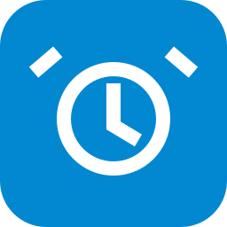

# Wecker

Home-Assistant-Integration mit vollständig bearbeitbaren Weckerkarten und gemeinsamen Tagestypen. Version **1.6.0**, unverändertes **HA UI Kit 1.4.1**.

## Funktionen

- Eigene Tagestypen mit Namen, Symbolen, Wochentagen und optional einem Kalender. Im Setup festlegen: freie oder gebuchte Kalendertage; nur ganztägige Termine zählen.
- Einen Tagestyp wie **Schultag** bei Maximilian anlegen und bei Paul aus dem gemeinsamen Katalog verwenden. Namen, Symbole, Wochentage und Kalenderregeln werden gemeinsam gepflegt. Uhrzeiten, Aktivierungen, Musikverhalten und Ausschaltbestätigungen bleiben je Karte getrennt.
- Zentrale Verwaltung unter **Zahnrad → Tagestypen verwalten**: Anlegen, gemeinsame Regeln ändern, Verwendung sehen und unbenutzte Typen löschen. Wiederholtes Übernehmen fügt keinen zweiten Wecker hinzu.
- Im Setup unter **Licht** passende Hue-Szenen auswählen. Nur Szenen, die keine zusätzlichen Lampen schalten, werden angeboten. Helligkeit und Farben kommen dann aus der Szene; weitere gewählte Lampen bleiben individuell einstellbar.
- Zusätzliche kompakte **Wecker-Status**-Karte: Name, Tagessymbole und An/Aus. Zum Beispiel Maximilian und Paul nebeneinander: [Anleitung und YAML](docs/STATUSKARTE.md).
- Ein-/Ausschalten mit optionaler Bestätigung, Stunden-/Minutenräder und bis zu drei Schnellzeiten je Typ. Änderungen werden zentral gespeichert.
- **Blaue Tagessymbole:** Der aktivierte Wecker ist innerhalb der nächsten 24 Stunden fällig. **Graue Tagessymbole:** Keine passende Ausführung in diesem Zeitraum. Kalenderregeln, Wochentage, erledigte Ausführungen und Zeitumstellungen werden berücksichtigt. Es gibt keine dritte Statusfarbe und keine Tagesüberschrift.
- Unter dem Zahnrad: Lautstärke 5–15 %, Schnellzeiten und Sonnenaufgang je Tagestyp. Der schmale Dialog zeigt die Versionsnummer.
- Administratoren können über **Gesamte Karte bearbeiten** oder im Karteneditor Konto, Boxen, Rollläden, Licht und Tagestypen ändern, ohne die Karte neu anzulegen.
- Genau ein persönliches Musikkonto pro Karte und mehrere Sonos-Boxen. Mehrere Rollläden mit Zielposition sowie mehrere Lichter mit Helligkeit/Farbtemperatur/Farbe sind möglich.
- Zentrale Ausführung in Home Assistant auch bei geschlossenem Dashboard. Die gewählte Musik gilt für alle Typen; Musik endet nach fünf Minuten.

## Installation und Update

1. [Music Manager](https://github.com/v9h45n47mh-lab/music-manager) ab **2.1.0** mit Music Assistant und persönlicher Apple-Music-Zuordnung einrichten. Gewünschte Boxen für das jeweilige Konto freigeben.
2. In HACS `https://github.com/v9h45n47mh-lab/wecker-manager` als benutzerdefiniertes Repository vom Typ **Integration** hinzufügen und **Wecker** installieren.
3. Home Assistant neu starten und **Wecker** unter Geräte & Dienste hinzufügen.
4. Eine Dashboardkarte **Wecker** hinzufügen. **Tagestypen → Musik → Rollläden → Licht → Prüfen** durchlaufen und anschließend das Dashboard speichern.

Beim Update in HACS aktualisieren, Home Assistant neu starten und den Browser vollständig neu laden (**Strg+F5**). Vorhandene Karten, Musikauswahl, Zeiten und Sonnenaufgangseinstellungen bleiben erhalten. Gemeinsame Tagestypen werden aus den vorhandenen Definitionen übernommen. Alte Kalenderregeln bleiben bestehen.

Die Dashboard-Ressource wird automatisch registriert. Dieses Paket installiert ausschließlich `custom_components/wecker_manager`; die separat installierte Music-Manager-Integration wird nicht ersetzt.

## Umstellung alter YAML-Wecker

Die neue Integration benötigt keine YAML-Weckerhelfer. Bereits angelegte Karten verwenden ihre gespeicherten Werte. Die alten Automationen **M – Wecker** und **P – Wecker** müssen bei einer Umstellung selbst deaktiviert werden; das Entfernen einer alten Dashboardkarte beendet keine Automation. Geräte, Kalender und weiterhin verwendete Music-Manager-Zuordnungen bleiben erhalten. [Aufräumen alter Wecker](docs/ALTE_WECKER.md).

[Einrichtung und Bedienung](docs/WECKERKARTE.md) · [UI-Kit-Prüfung](docs/UI_KIT_PRUEFUNG.md)

## Entwicklung und Prüfung

`npm ci`, `npm run build`, `npm run check`, `npm test`, `npm run test:browser`. `CHROMIUM_PATH` kann den Browser vorgeben. Die Backendtests verwenden den separat ausgecheckten Music Manager am Commit `5b312361676197bf1178ce76b63ab46ac76d3975` über `MUSIC_MANAGER_SOURCE` oder `.test-deps/music-manager`.

`python3 scripts/package.py` erzeugt das Installationspaket und eine eigenständige Vorschau mit Beispieldaten. Das UI Kit wird lokal mit festen Prüfsummen gebündelt; es gibt keinen Laufzeitabruf von GitHub oder einem CDN.

## Radiosender als Weckmusik (1.6.0)

Mit Music Manager ab **2.2.0** lassen sich Radiosender zum Wecken markieren und auf der Weckerkarte auswählen. Die Auswahl gilt wie die Apple-Music-Auswahl für alle Tagestypen; Musikschalter, Lautstärke und das Ende nach fünf Minuten gelten unverändert. Der Radiosender startet nativ auf allen zugeordneten Sonos-Boxen, auch wenn Music Assistant beim Wecken nicht verbunden ist. Benutzer- und Gerätebindungen werden weiterhin geprüft. Bestehende Apple-Music-Auswahlen und alle Tagestyp- und Hue-Szenen-Einstellungen bleiben erhalten.
